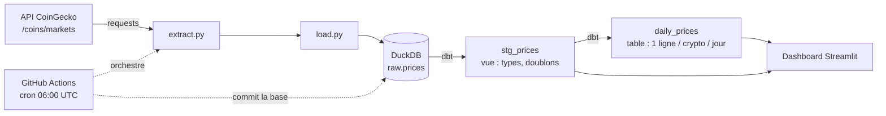

# mini-etl-pipeline


Pipeline **ELT** de bout en bout, automatisé et testé : chaque jour, il récupère les prix de cryptomonnaies sur l'API CoinGecko, les charge dans une base DuckDB, les transforme avec dbt, vérifie leur qualité, puis publie le résultat. Un dashboard Streamlit animé permet de les explorer.

Projet personnel pour pratiquer les briques d'un pipeline moderne : extraction, chargement, transformation SQL, tests de qualité, conteneurisation et orchestration.

## Sommaire

- [Ce que fait le projet](#ce-que-fait-le-projet)
- [Architecture](#architecture)
- [Stack technique](#stack-technique)
- [Démarrage rapide](#démarrage-rapide)
- [Configuration (.env)](#configuration-env)
- [Fonctionnement détaillé](#fonctionnement-détaillé)
- [Modèle de données](#modèle-de-données)
- [Tests et qualité](#tests-et-qualité)
- [Automatisation (GitHub Actions)](#automatisation-github-actions)
- [Dashboard](#dashboard)
- [Structure du dépôt](#structure-du-dépôt)
- [Dépannage](#dépannage)
- [Choix, limites et pistes d'amélioration](#choix-limites-et-pistes-damélioration)

## Ce que fait le projet

1. **Extrait** les prix, capitalisations et volumes de 5 cryptomonnaies (Bitcoin, Ethereum, Solana, Cardano, Ripple) depuis l'API CoinGecko.
2. **Charge** ces données brutes, sans modification, dans la table `raw.prices` de DuckDB.
3. **Transforme** avec dbt : nettoyage et dédoublonnage (`stg_prices`), puis agrégation journalière (`daily_prices`).
4. **Vérifie** la qualité des données avec des tests dbt (unicité, valeurs non nulles) et des tests Python (pytest).
5. **S'exécute tout seul** chaque jour à 06:00 UTC via GitHub Actions, qui commite la base mise à jour.
6. **Affiche** les résultats dans un dashboard Streamlit.

## Architecture



C'est un **ELT** et non un ETL : les données sont chargées brutes d'abord, puis transformées en SQL dans la base. On garde ainsi la donnée d'origine et on peut refaire les transformations à tout moment.

## Stack technique

| Outil | Rôle | Pourquoi ce choix |
|---|---|---|
| Python 3.12 + `requests` | extraction depuis l'API | simple, lisible |
| DuckDB | base analytique | un seul fichier, aucun serveur à installer |
| dbt (dbt-duckdb) | transformations SQL | versionnées, testées, documentées |
| pytest | tests Python | tests de l'extraction et du chargement |
| Docker + Compose | environnement reproductible | même résultat sur toutes les machines |
| GitHub Actions | orchestration et CI | gratuit, intégré au dépôt |
| Streamlit + Plotly | dashboard | interactif et animé, en Python |

## Démarrage rapide

### Avec Docker (recommandé)

```bash
git clone https://github.com/Ethan941/mini-etl-pipeline.git
cd mini-etl-pipeline
cp .env.example .env       # puis renseigner COINGECKO_API_KEY si tu en as une
docker compose run --rm --build pipeline
```

La commande lance l'extraction, le chargement, puis `dbt build` (modèles et tests). La base est écrite dans `data/crypto.duckdb`.

### Sans Docker

Python **3.12** est requis : dbt ne supporte pas encore les versions plus récentes.

```bash
python3.12 -m venv .venv
source .venv/bin/activate
pip install -r requirements.txt
cp .env.example .env
set -a && . ./.env && set +a          # charge les variables pour dbt

python src/main.py                                  # extraction + chargement
dbt build --project-dir dbt --profiles-dir dbt      # transformations + tests dbt
pytest                                              # tests Python
```

Lance toujours les commandes **depuis la racine du dépôt** : le chemin de la base est relatif à la racine.

### Lancer le dashboard

```bash
pip install -r requirements-dashboard.txt
streamlit run dashboard/app.py
```

## Configuration (.env)

Copie `.env.example` vers `.env`. Le fichier `.env` est ignoré par git : il ne doit jamais être commité.

| Variable | Rôle | Valeur par défaut |
|---|---|---|
| `COINGECKO_API_KEY` | clé API « Demo » gratuite (optionnelle) | vide |
| `COINS` | identifiants CoinGecko des cryptos suivies, séparés par des virgules | `bitcoin,ethereum,solana,cardano,ripple` |
| `VS_CURRENCY` | devise de référence | `eur` |
| `DUCKDB_PATH` | emplacement du fichier de base | `data/crypto.duckdb` |

Sans clé, l'API publique fonctionne mais le nombre d'appels est plus limité. Sur GitHub, la clé est stockée dans **Settings > Secrets and variables > Actions** sous le nom `COINGECKO_API_KEY`.

Pour suivre d'autres cryptos, ajoute leurs identifiants dans `COINS` (liste sur [coingecko.com](https://www.coingecko.com)).

## Fonctionnement détaillé

### 1. Extraction (`src/extract.py`)
`fetch_markets()` appelle l'endpoint `/coins/markets` avec la liste des cryptos et la devise. Elle ne garde que les champs utiles : `id`, `symbol`, `current_price`, `market_cap`, `total_volume`, `price_change_percentage_24h`, `last_updated`. Une erreur HTTP (par exemple 429, limite d'appels) remonte immédiatement au lieu d'être masquée, ce qui fait échouer le pipeline de façon visible.

### 2. Chargement (`src/load.py`)
`load_raw()` crée le schéma `raw` et la table `raw.prices` si besoin, puis **ajoute** les lignes (jamais d'écrasement). Chaque ligne reçoit un horodatage de chargement `loaded_at`. Les données brutes s'accumulent donc exécution après exécution.

### 3. Transformation (dbt)
- `stg_prices` (vue) : convertit les types, met le symbole en majuscules, supprime les lignes sans prix et retire les doublons (même crypto et même `last_updated` : on garde le dernier chargement).
- `daily_prices` (table) : une ligne par crypto et par jour avec le dernier prix, la moyenne, le minimum, le maximum, la variation 24 h et le nombre d'observations.

### 4. Orchestration
`src/main.py` enchaîne extraction et chargement. `dbt build` exécute ensuite les modèles et leurs tests. Le tout est lancé par le conteneur Docker ou par le workflow GitHub Actions.

## Modèle de données

### `raw.prices` (données brutes)

| Colonne | Type | Description |
|---|---|---|
| `id` | VARCHAR | identifiant CoinGecko (`bitcoin`) |
| `symbol` | VARCHAR | symbole (`btc`) |
| `current_price` | DOUBLE | prix en devise de référence |
| `market_cap` | DOUBLE | capitalisation de marché |
| `total_volume` | DOUBLE | volume échangé sur 24 h |
| `price_change_percentage_24h` | DOUBLE | variation sur 24 h, en % |
| `last_updated` | VARCHAR | date de mise à jour côté CoinGecko |
| `loaded_at` | TIMESTAMP | date de chargement dans la base |

### `stg_prices` (vue de nettoyage)
Mêmes colonnes avec `last_updated` en TIMESTAMP, `symbol` en majuscules, et une clé `price_key` (`id|last_updated`) unique par observation.

### `daily_prices` (table finale)

| Colonne | Description |
|---|---|
| `daily_key` | clé unique `id|date` |
| `id`, `symbol`, `price_date` | crypto et jour |
| `close_price` | dernier prix du jour |
| `avg_price`, `min_price`, `max_price` | statistiques du jour |
| `change_24h_pct` | variation 24 h à la dernière observation |
| `nb_observations` | nombre de relevés dans la journée |

Exemple de requête sur la base :

```bash
python -c "import duckdb; print(duckdb.connect('data/crypto.duckdb', read_only=True).sql('select * from main.daily_prices order by price_date desc'))"
```

## Tests et qualité

| Type | Où | Ce qui est vérifié |
|---|---|---|
| pytest | `tests/test_pipeline.py` | l'extraction ne garde que les champs attendus ; le chargement ajoute les lignes sans écraser et horodate |
| dbt | `dbt/models/schema.yml` | `unique` et `not_null` sur les clés, `not_null` sur les prix : 7 tests |

Les tests pytest tournent sans réseau (l'appel API est simulé). Les tests dbt s'exécutent avec `dbt build`, juste après chaque modèle.

## Automatisation (GitHub Actions)

Le workflow `.github/workflows/pipeline.yml` se déclenche :
- **chaque jour à 06:00 UTC** (cron) ;
- **à la demande** depuis l'onglet Actions (`workflow_dispatch`).

Étapes : installation des dépendances, `pytest`, extraction et chargement, `dbt build`, puis commit de `data/crypto.duckdb` par `github-actions[bot]` si la base a changé. Si une étape échoue, le workflow s'arrête et GitHub envoie un mail.

## Dashboard

Le dashboard **Crypto Pulse** (`dashboard/app.py`) lit la base en lecture seule.

- **Cartes par crypto** : prix animé, courbe qui se dessine, variation 24 h.
- **Évolution** : courbes comparées (base 100 ou valeurs réelles) avec un bouton « Rejouer ».
- **Variation 24 h** : barres vertes ou rouges.
- **Volume × capitalisation** : bulles animées dans le temps.
- **Filtres** : cryptos, période (24 h, 7 j, 30 j, tout), métrique (prix, capitalisation, volume).
- **Mode démo** : historique simulé sur 60 jours tant que le pipeline n'a pas accumulé assez de données. Un badge indique clairement que les données sont simulées.

## Structure du dépôt

```
mini-etl-pipeline/
├── src/
│   ├── extract.py        appel API CoinGecko
│   ├── load.py           écriture dans DuckDB
│   └── main.py           point d'entrée (extraction + chargement)
├── dbt/
│   ├── dbt_project.yml
│   ├── profiles.yml
│   └── models/
│       ├── sources.yml
│       ├── schema.yml    tests de qualité
│       ├── staging/stg_prices.sql
│       └── marts/daily_prices.sql
├── dashboard/app.py      dashboard Streamlit
├── tests/                tests pytest
├── data/                 base DuckDB (mise à jour par le workflow)
├── .github/workflows/    pipeline quotidien
├── Dockerfile
├── docker-compose.yml
├── requirements.txt
├── requirements-dashboard.txt
└── .env.example
```

## Dépannage

| Problème | Cause et solution |
|---|---|
| `dbt` plante au démarrage avec une erreur `mashumaro` | Python trop récent. Utilise Python 3.12. |
| `Catalog Error` ou table introuvable dans dbt | Le chargement n'a pas encore tourné. Lance d'abord `python src/main.py`. |
| Erreur HTTP 429 à l'extraction | Limite d'appels de l'API. Ajoute une clé Demo dans `.env` ou attends. |
| `git pull` refuse à cause de `data/crypto.duckdb` | Le workflow a commité la base. Lance `git restore data/crypto.duckdb` puis `git pull`. |
| Le workflow échoue avec `Internal Server Error` au push | Erreur temporaire côté GitHub. Relance avec « Re-run failed jobs ». |
| Le dashboard affiche « Aucune donnée » | Lance le pipeline, ou active le mode démo dans la barre latérale. |

## Choix, limites et pistes d'amélioration

**Choix**
- GitHub Actions plutôt qu'Airflow : un seul appel par jour ne justifie pas un orchestrateur dédié.
- DuckDB plutôt qu'un serveur de base : zéro infrastructure, parfait pour un projet de cette taille.
- Données brutes conservées : les transformations peuvent être refaites à tout moment.

**Limites**
- La base est versionnée dans git. C'est simple et gratuit, mais le dépôt grossit à chaque commit. À remplacer par un stockage externe (S3, BigQuery) si le volume augmente.
- L'API gratuite limite le nombre d'appels et n'offre qu'un relevé par jour dans ce pipeline : l'historique se construit lentement.
- Pas d'alerte autre que le mail d'échec par défaut de GitHub.

**Pistes d'amélioration**
- Tests dbt supplémentaires (`dbt_utils.accepted_range` : prix strictement positif).
- Ajouter un test de fraîcheur des données (`dbt source freshness`).
- Passer sur BigQuery comme entrepôt cible.
- Déployer le dashboard sur Streamlit Community Cloud.
- Ajouter des captures d'écran du dashboard dans ce README.
