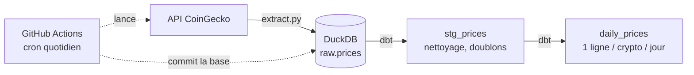

# mini-etl-pipeline


Pipeline ELT de bout en bout : il récupère chaque jour les prix de cryptomonnaies sur l'API CoinGecko, les charge dans DuckDB, les transforme avec dbt et se relance tout seul via GitHub Actions.

## Architecture



## Stack

| Outil | Rôle |
|---|---|
| Python (`requests`) | extraction depuis l'API |
| DuckDB | base analytique dans un seul fichier, sans serveur |
| dbt (dbt-duckdb) | transformations SQL versionnées et testées |
| pytest | tests de l'extraction et du chargement |
| Docker | même environnement partout |
| GitHub Actions | orchestration : cron quotidien à 06:00 UTC |

## Lancer en local

```bash
git clone https://github.com/Ethan941/mini-etl-pipeline.git
cd mini-etl-pipeline
cp .env.example .env          # puis remplir COINGECKO_API_KEY (optionnelle)
docker compose run --rm --build pipeline
```

Sans Docker (Python 3.12 requis, dbt ne supporte pas encore les versions plus récentes) :

```bash
python3.12 -m venv .venv && .venv/bin/pip install -r requirements.txt
set -a && . ./.env && set +a
.venv/bin/python src/main.py
.venv/bin/dbt build --project-dir dbt --profiles-dir dbt
.venv/bin/pytest
```

## Structure

```
src/        extract.py, load.py, main.py
dbt/        modèles staging et marts, tests de qualité
tests/      tests pytest
.github/    workflow quotidien
data/       base DuckDB (mise à jour par le workflow)
```

## Modèles dbt

- `stg_prices` : types corrigés, doublons retirés (même crypto et même `last_updated`).
- `daily_prices` : par crypto et par jour, dernier prix, moyenne, min, max, variation sur 24 h, nombre d'observations.

Tests : `unique` et `not_null` sur les clés, `not_null` sur les prix.

## Choix et limites

- **GitHub Actions plutôt qu'Airflow** : un seul appel par jour ne justifie pas un orchestrateur.
- **Base versionnée dans git** : simple et gratuit pour un mini projet, mais le dépôt grossit à chaque commit. À remplacer par un stockage externe (S3, BigQuery) si le volume augmente.
- **API gratuite** : limitée en nombre d'appels. Une clé Demo est stockée dans les secrets GitHub (`COINGECKO_API_KEY`).
